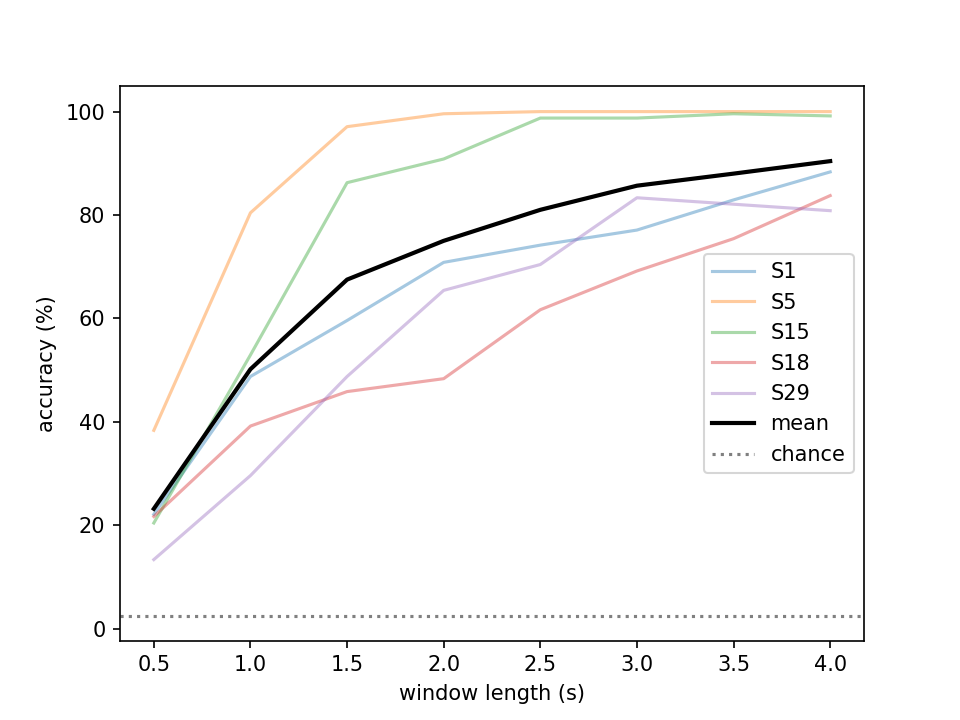

# ssvep-pipeline

A small learning project: loading a public ssvep eeg dataset with MNE-Python, filtering it, looking at its spectrum, and detecting which flicker frequency a person was looking at with CCA.

This is not research. It is a first pass at working with eeg data, written to learn MNE, SciPy and the basics of ssvep detection.

## Data

[Tsinghua SSVEP benchmark dataset](https://bci.med.tsinghua.edu.cn) (Wang et al., 2016, IEEE TNSRE). Each subject looked at 40 flickering targets (8 to 15.8 Hz), 6 times each. Trials are already epoched: 64 channels, 6 s at 250 Hz (0.5 s before the flicker, 5 s of flicker, 0.5 s after).

Subjects used here: S1, S5, S15, S18, S29.

Put `S*.mat`, `Freq_Phase.mat` and `64-channels.loc` in a `data/` folder. The data is not in this repo.

Targets are not sorted by frequency in `Freq_Phase.mat` (8, 9, ... 15, then 8.2, 9.2, ...), so frequencies are always looked up with `freqs[label]`.

## What it does

1. `pipeline.py`: loads a subject into an MNE `EpochsArray`, keeps 9 occipital channels (POz, Oz, O1, O2, PO3-PO6, Pz), applies a 50 Hz notch (China mains) and a 6-90 Hz bandpass.
2. `cca.py`: CCA detection. For each of the 40 target frequencies it builds sine and cosine references (5 harmonics), computes the largest canonical correlation with the eeg window, and picks the frequency with the highest score.
3. `run_accuracy.py`: accuracy against window length (0.5 to 4 s), with the window starting 0.64 s after trial start (0.5 s pre-stimulus plus about 0.14 s visual delay).

`01_explore.ipynb` has the loading steps and power spectra for a few targets, where peaks show up at the flicker frequency and its harmonics.

## Run

```
pip install -r requirements.txt
python run_accuracy.py
```

## Results



Accuracy (%) per subject, 40 classes, chance is 2.5%:

| window | S1 | S5 | S15 | S18 | S29 | mean |
|---|---|---|---|---|---|---|
| 1 s | 49 | 80 | 53 | 39 | 30 | 50 |
| 2 s | 71 | 100 | 91 | 48 | 65 | 75 |
| 4 s | 88 | 100 | 99 | 84 | 81 | 90 |

Mean accuracy rises from 23% at 0.5 s to 90% at 4 s. Subjects differ a lot: S5 is at 100% from 2 s, while S18 and S29 stay lower and need longer windows. Each point is 240 trials per subject, and there are only 5 subjects, so small differences (for example S29 dropping slightly between 3 s and 4 s) should not be read as meaningful.

## Limitations

- 5 subjects only.
- No artifact removal beyond filtering and channel selection. ICA was skipped because the data comes as short epochs.
- Standard CCA only, no filter bank or training-based methods.
- Window start is fixed at 0.64 s, and the number of reference harmonics (5) was not tuned.